# 🚀 Vineet Prakash Diwakar | Full-Stack Flutter Developer

  

  
  
  
  

---

> **I build mobile products that are useful, polished, and ready for real users.**
>
> Flutter for the experience · Firebase / Supabase for the foundation · Gemini for intelligent workflows

| **Cabswale** | **2 production apps** | **500K+** | **50K+** |
|:---:|:---:|:---:|:---:|
| Flutter Developer experience | Android + iOS delivery | Driver app downloads | Customer app downloads |

  <strong>At Cabswale: reduced Firebase costs by 50-60% through query, listener, and caching improvements.</strong>

## 👨‍💻 About Me

> **Flutter Developer · Mobile Product Engineer · AI Enthusiast**

I design and ship cross-platform mobile applications with a focus on **clean architecture, responsive UI, reliable data flows, and thoughtful product details**. My work spans production mobility products, AI made simple for everyday use, wallpaper commerce, travel planning, finance, and voice-powered sports tools.

### 🎯 What I am looking for

Flutter Developer, Mobile Application Developer, and AI-enabled product roles with teams building consumer apps, marketplaces, developer tools, or intelligent workflows.

## 🌟 Featured Projects

### 🎨 Fluids — 4K HD Wallpapers

<strong>📱 View the full Fluids screen gallery</strong> · Google Play screenshots

<table>
<tr>
<td><a href="assets/fluids/1.png">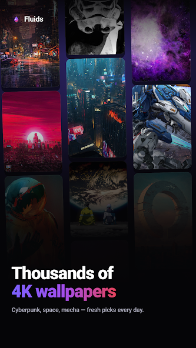</a></td>
<td><a href="assets/fluids/2.png">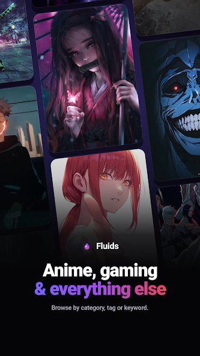</a></td>
<td><a href="assets/fluids/3.png">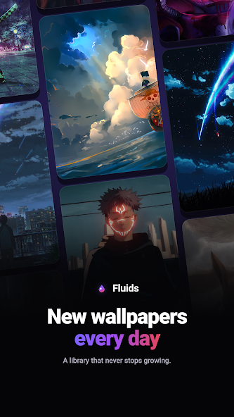</a></td>
<td><a href="assets/fluids/4.png">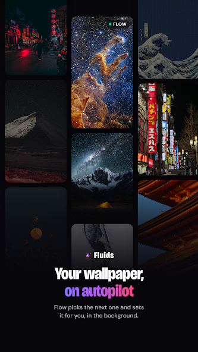</a></td>
<td><a href="assets/fluids/5.png">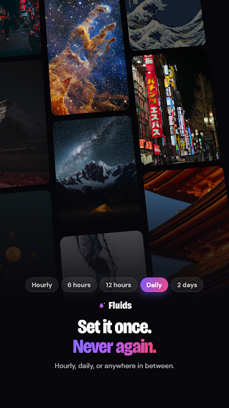</a></td>
<td><a href="assets/fluids/6.png">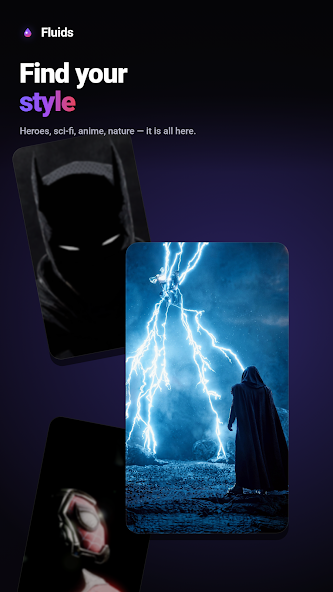</a></td>
<td><a href="assets/fluids/7.png">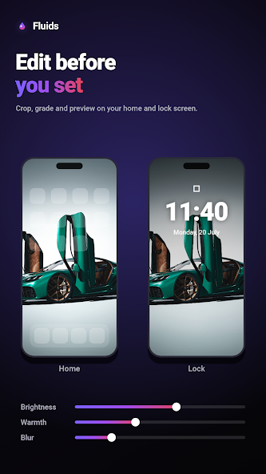</a></td>
<td><a href="assets/fluids/8.png">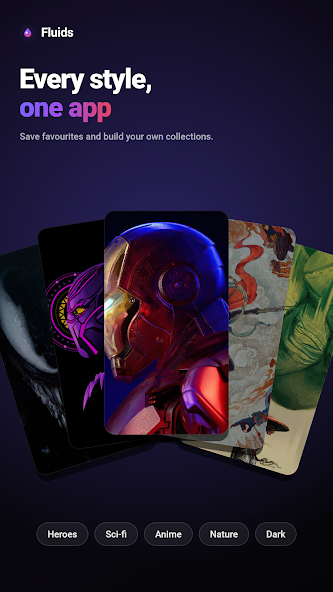</a></td>
</tr>
</table>

**A wallpaper product designed, built, and launched independently.**

- Built with **Flutter, Riverpod, Clean Architecture, Supabase, Postgres, and Edge Functions**.
- Added personalized feeds, offline caching, deep links, background wallpaper scheduling, and home / lock screen controls.
- Implemented Google Play Billing with purchase verification, refund handling, and a 14-day Flow trial.
- Designed a clean, modern experience for discovering, editing, saving, and applying HD and 4K wallpapers.

  <a href="https://play.google.com/store/apps/details?id=cc.fluids.app"><strong>↗ View Fluids on Google Play</strong></a>

---

### 🤖 Kettle AI — AI Made Simple

<strong>📱 View the full Kettle AI screen gallery</strong> · testing build screenshots

<table>
<tr>
<td><a href="assets/kettle/01-ask.png">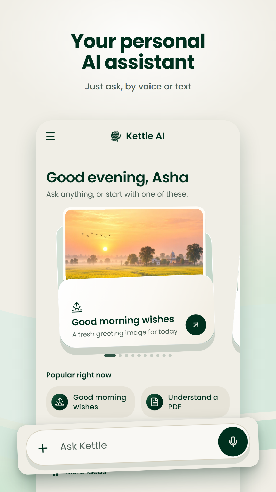</a></td>
<td><a href="assets/kettle/02-cards.png">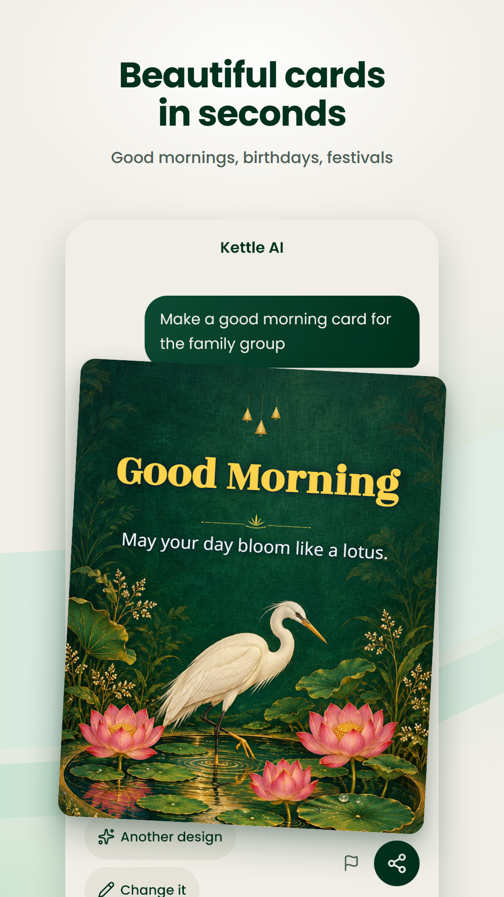</a></td>
<td><a href="assets/kettle/03-reminders.png">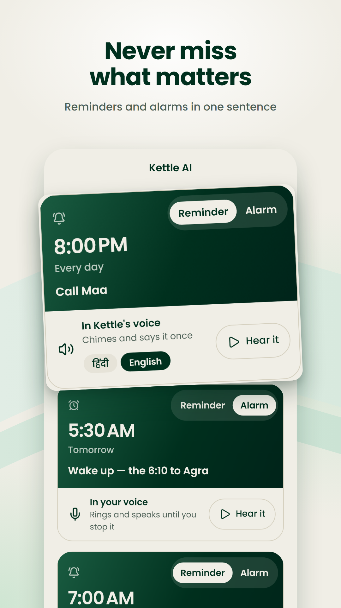</a></td>
<td><a href="assets/kettle/04-answers.png">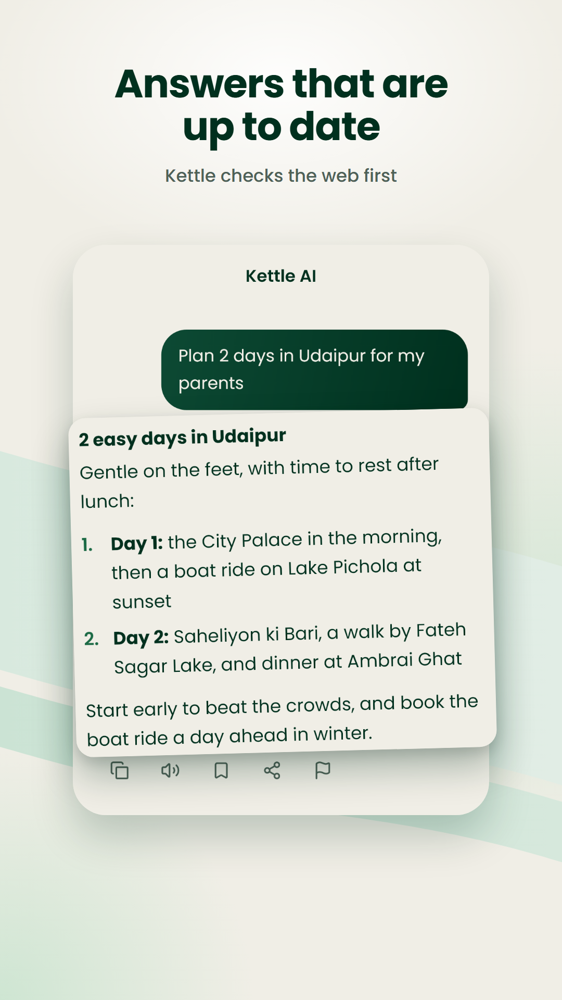</a></td>
<td><a href="assets/kettle/05-letters.png">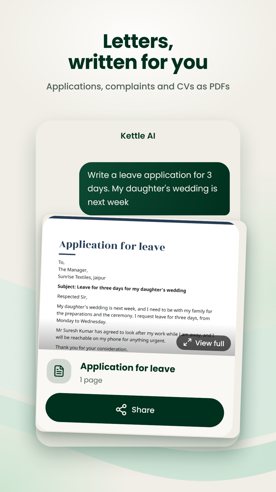</a></td>
<td><a href="assets/kettle/06-places.png">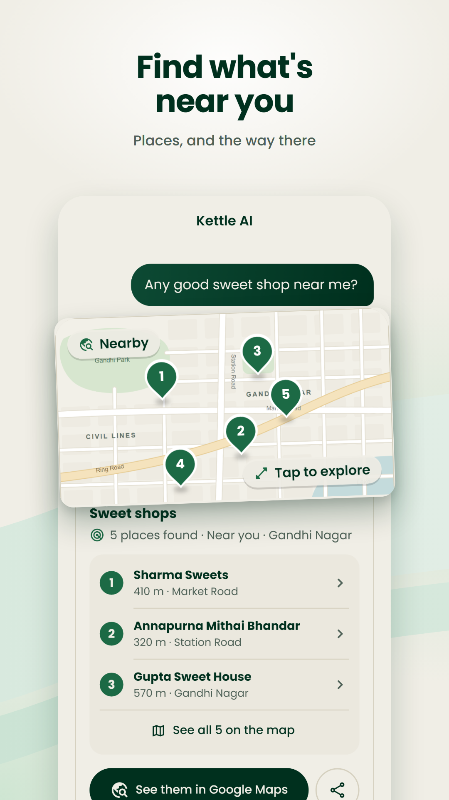</a></td>
<td><a href="assets/kettle/07-papers.png">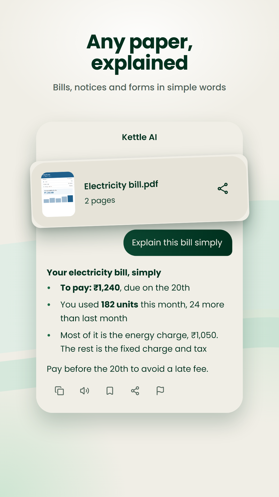</a></td>
<td><a href="assets/kettle/08-language.png">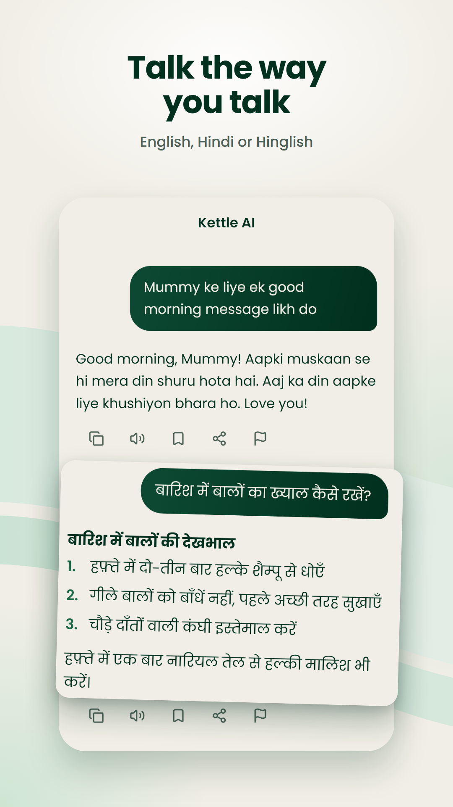</a></td>
</tr>
</table>

**Currently in Google Play testing · available through the testing link**

**AI Made Simple.** Kettle AI is a practical chatbot for everyday questions, writing, documents, images, search, reminders, and shareable outputs. It is designed to feel approachable for people who want useful AI without a steep learning curve, with Hindi, Hinglish, voice, and older-user-friendly flows.

- Ask questions by typing or voice and receive clear, useful answers.
- Read photos and PDFs, search the web, understand documents, and get help with everyday decisions.
- Create shareable greetings, invitations, documents, spreadsheets, and map cards for WhatsApp.
- Use Hindi, English, or Hinglish with voice input and memory that remains visible and editable.

  <a href="https://play.google.com/store/apps/details?id=com.getkettleai.app"><strong>↗ Open the Kettle AI testing link</strong></a>

---

### ✈️ Smart Trip Planner

**AI-powered travel planning with persistent context**

- Gemini function calling across flights, hotels, Google Places, web search, and budgets.
- Structured JSON itineraries rendered as editable cards with map and route previews.
- Persistent trips and chats with Hive, offline use, retry handling, and token-budget awareness.

---

### 🧠 AI Companion

**Conversational AI with persistent memory and voice interaction**

- Google Gemini conversations with Supabase authentication and Hive offline caching.
- Session persistence, mood and personality insights, and voice input / output.
- Clean navigation with go-router and graceful online / offline transitions.

---

### 🎾 GameOn — Voice Sports Scoring

**Voice-assisted scoring for tennis and pickleball**

- Official tennis and pickleball scoring logic with tiebreakers and serve rotation.
- Voice commands, match analytics, tournament brackets, match history, and live sharing.
- State-machine game logic, background audio processing, Firebase, and Auth0.

## 💼 Experience

### Cabswale — Flutter Developer

**Apr 2026 - Oct 2026 · Gurugram, India**

- Developed and maintained two production Flutter applications for Android and iOS: a driver community app and a customer booking app.
- Contributed to products with **500K+ driver-community downloads** and **50K+ customer-booking downloads**.
- Improved Firebase responsiveness and reduced Firebase costs by **50-60%** through query, listener, and caching improvements.
- Worked with an AI engineering team through pull requests and peer reviews.

### CarriBiz Global Logistics — Flutter Developer, Contract

**Dec 2025 - Jan 2026 · Hyderabad, India**

Built a logistics platform with Clean Architecture, real-time tracking, push notifications, cloud functions, object storage, and DevOps-aligned delivery workflows.

### ReCrooters — Flutter Developer Intern

**Jun 2025 - Aug 2025 · Remote**

Built backend-to-frontend API integrations for two MVP products and architected a real-time allergen-detection algorithm with **94% accuracy**.

## 🛠️ Technical Arsenal

| Area | Tools and capabilities |
| --- | --- |
| Architecture | Clean Architecture, BLoC, Riverpod, Provider, GetX, repository pattern, dependency injection |
| Backend | Firebase, Supabase, REST APIs, WebSockets, cloud functions, Postgres |
| Data | SQLite, Drift, Hive, SharedPreferences, offline sync, caching |
| Product craft | Material 3, responsive UI, custom animation, accessibility, profiling, testing |
| AI | Gemini, function calling, structured output, prompt engineering, token-aware workflows |

## 🎓 Education & Leadership

**Birla Institute of Technology, Mesra**

Bachelor of Technology in Computer Science and Engineering · 2022-2026

**Smart India Hackathon 2024 · Technical Lead**

Led the engineering and deployment of an online scholarship distribution system for PMSSS.

## 🤝 Let’s Connect

I am actively looking for Flutter, mobile application, and AI-enabled product roles.

  

*Building useful digital experiences, one release at a time.*

